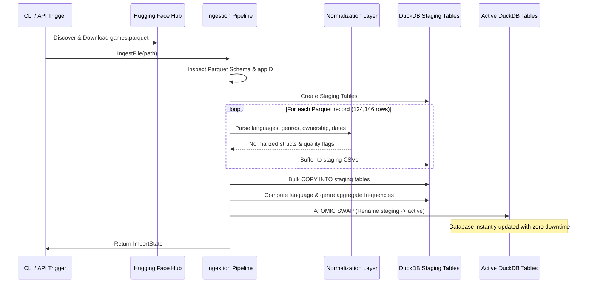

# System Architecture

The **Steam Localization Gap Atlas** is structured as an analytical monorepo comprising a high-performance Go analytical engine and a React/TypeScript research interface.

```
+-----------------------------------------------------------------------------------+
|                                  USER / BROWSER                                   |
|                      React + TypeScript Single-Page Application                   |
+-----------------------------------------+-----------------------------------------+
                                          | HTTP REST / CSV Downloads
                                          v
+-----------------------------------------------------------------------------------+
|                                GO HTTP API SERVER                                 |
|                       (internal/api, net/http, CORS, JSON)                        |
+-----------------------------------------+-----------------------------------------+
                                          |
                      +-------------------+-------------------+
                      |                                       |
                      v                                       v
+---------------------------------------+   +---------------------------------------+
|          ANALYTICS ENGINE             |   |          INGESTION PIPELINE           |
| (internal/analytics, matrix, gaps)   |   | (internal/ingestion, staging, atomic) |
+-------------------+-------------------+   +-------------------+-------------------+
                    |                                           |
                    | Parameterized SQL Queries                 | Bulk Loading & Atomic Swap
                    v                                           v
+-----------------------------------------------------------------------------------+
|                             EMBEDDED DUCKDB ENGINE                                |
|                        (data/atlas.duckdb - 124,146 games)                        |
+-----------------------------------------------------------------------------------+
```

---

## 1. Major Components

### 1.1 Ingestion & Normalization (`internal/ingestion`, `internal/normalization`)

- **Discovery & Download:** Queries the public Hugging Face API to discover shards, verify file hashes, and stream downloads with progress reporting.
- **Normalization Engine:** Pure Go parsers for languages, genres, dates, ownership brackets, and playtests. Handles HTML markup, entities, delimiters, deduplication, and dialect preservation.
- **Staging & Bulk Loading:** Normalizes rows in Go and loads them into temporary DuckDB staging tables via vectorized `COPY FROM` operations (124k records in ~3 seconds).
- **Atomic Replacement:** Transactionally swaps staging tables into active production tables using DDL renames. A failed ingestion never corrupts the live database.

### 1.2 Analytical Database (`internal/database`, DuckDB)

- Embedded columnar analytical database stored at `data/atlas.duckdb`.
- Query execution over 124,146 games, 650,000 language relationships, and 333,000 genres executes in 20–80 milliseconds without requiring an external database server.
- Maintains distinct counts for accurate multi-genre denominators.

### 1.3 Analytical Engine (`internal/analytics`)

- Authoritative calculation of matrix cells (numerators, denominators, coverage percentages, and low-sample flags).
- Dynamic global filter application across release years, platforms, pricing, genres, and playtest exclusions.
- Multi-genre comparative deltas and gap calculations.

### 1.4 REST API & CLI (`internal/api`, `cmd/atlas`)

- REST API under `/api/v1` with structured JSON responses, input validation, and streaming CSV export handlers.
- CLI subcommands: `serve`, `ingest`, `inspect`, `validate`, `export`.
- Single-binary deployment: Serves the built React SPA assets directly from `apps/web/dist` when present.

### 1.5 Research Interface (`apps/web`)

- React 18, TypeScript, Tailwind CSS, Lucide icons.
- Interactive Localization Matrix with sticky headers/columns, color scale, hover/focus inspection cards, and click-through navigation.
- Light and dark editorial visual themes.

---

## 2. Ingestion & Atomic Replacement Workflow



---

## 3. Performance & Reliability Guarantees

1. **Sub-Second API Responses:** DuckDB's vectorized columnar execution calculates aggregates on demand without storing massive pre-computed JSON files.
2. **Zero Ingestion Downtime:** Because staging tables are populated in isolation, active queries continue to run during an import until the atomic swap.
3. **Reproducible Calculations:** Denominators and numerators are calculated authoritatively by the Go backend to ensure identical results across the web interface and CSV exports.
